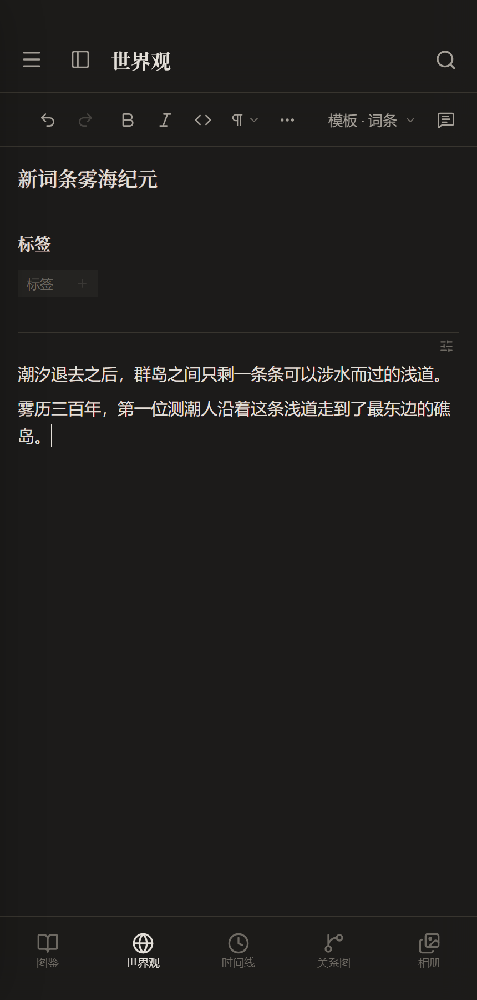
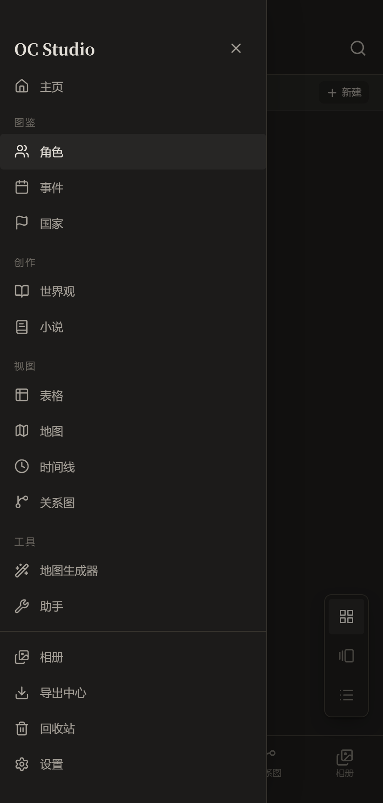
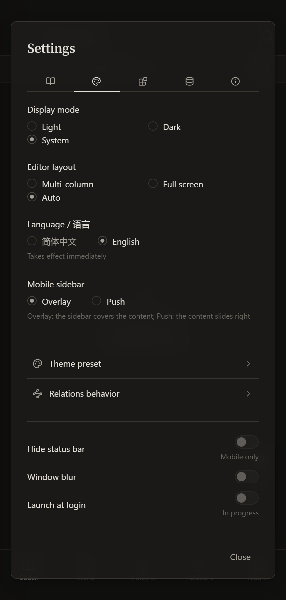

# OC Studio · Android

> [!IMPORTANT]
> **此项目仅作移植参考，将不会继续更新，用户可自行拿来自主更新（fork 后自维护）。**
> 上游 [OC Studio](https://github.com/Pokanshuu/OC-Studio) 仍在更新，功能与修复请以上游为准；
> 这里保留的是「如何把 Next.js + Tauri 项目搬到 Capacitor Android」的一份可运行样例。
>
> *This project is a porting reference only and will not be maintained. Fork it and maintain your own copy.*

**OC Studio 的安卓移植版（非官方）** — 面向 Android 手机 / 平板的本地优先创作工作台：角色、事件、国家、世界观词条、小说、时间线、关系图、地图、相册。

> 本项目是 [Pokanshuu/OC-Studio](https://github.com/Pokanshuu/OC-Studio)（MIT）的**第三方 Android 移植**，
> 与原项目作者无隶属或背书关系。上游桌面版（Windows / Tauri）请见上方的项目地址。
> 移植部分的改动见 [PORTING.md](PORTING.md)，逐版变更见 [CHANGELOG.md](CHANGELOG.md)。

[English summary ↓](#english)

## 截图

| 词条编辑器 | 左侧抽屉 | 设置（英文界面） |
|---|---|---|
|  |  |  |

> 430 × 900 CSS 像素（约 6.7 寸竖屏）下截的，深色主题。

## 这个版本做了什么

上游是 Next.js 静态导出 + Tauri 桌面壳。这里的做法是：**同一份 `src/`，外面套一层 Capacitor Android 壳**，再加上一层移动端外壳（Navigation / Drawer / TabBar）与若干 Android 适配。核心数据层、编辑器、导出器与上游一致。

| 能力 | 说明 |
|---|---|
| 本地优先 | 数据存 IndexedDB（移动端）。不需要账号，不联网也能用 |
| 移动外壳 | 顶部标题栏 + 底部五个分区（图鉴 / 世界观 / 时间线 / 关系图 / 相册）+ 左侧抽屉（覆盖 / 推移两种模式，可从左缘滑出） |
| 沉浸式状态栏 | 真隐藏（`WindowInsetsController`）+ ROM 适配；可在「设置 › 个性化」关掉 |
| 横竖屏 | 断点 768px：竖屏走移动外壳，横屏/平板走桌面外壳（侧栏 + 顶部菜单） |
| 多语言 | 简体中文 / English，首次安装弹语言选择；界面文案约 2000 条词条全覆盖 |
| 导出 | 备份 `.ocbak`、文档（Markdown / TXT / Word）、海报、网站、关系图、时间线、地图；移动端走「私有 Cache + 系统分享面板」 |

## 安装

到 [Releases](../../releases) 下载 `OC-Studio-*-android.apk`，手机上允许「安装未知来源应用」后安装。

- 最低 Android 7.0（API 24），目标 API 36
- 包名 `com.ocstudio.app`
- 覆盖安装会保留数据；卸载会删除本地数据（先导出 `.ocbak`）

## 自己构建

前置：**Node.js 20.9+**、**JDK 21**、**Android SDK 36 + Build-Tools 36**。

```bash
npm ci

# 1) 静态导出到 out/
npm run build

# 2) 同步进 Android 工程
npx cap sync android

# 3) 出包
cd android
./gradlew assembleRelease          # Windows: gradlew.bat assembleRelease
```

产出的未签名包在 `android/app/build/outputs/apk/release/app-release-unsigned.apk`。签名：

```bash
zipalign -p -f 4 app-release-unsigned.apk app-aligned.apk
apksigner sign --ks release.keystore --ks-key-alias <alias> --out app-release.apk app-aligned.apk
apksigner verify app-release.apk
```

`android/local.properties` 里写 `sdk.dir=<你的 SDK 路径>`（**不要提交**）。去掉 `applicationId` 里的品牌字样可避免与上游未来的官方包冲突，代价是换包名后老用户要重装。

CI：仓库自带 [`.github/workflows/build-apk.yml`](.github/workflows/build-apk.yml)，推 tag 或手动触发即可出包；签名材料放在仓库 Secrets。

## 已知限制

- **未在真机上做完整回归**：本移植的验证方式是「静态站点 + 无头浏览器」逐页截图与 DOM 断言，加上模拟器不可用（本机 WHPX 起不来）的现实。包能装、能跑，但 ROM 差异（尤其国产定制系统）只能靠反馈修。
- **动态拼接句**在英文下可能残留中文（`共 3 条` 这类由多段拼出来的句子）。
- 上游自身标 `开发中` 的功能（云同步、插件安装入口、部分模板组件）在移植版里同样是未完成状态 —— 没有额外砍功能。
- 桌面专属能力（本地笔记库文件夹、系统保存对话框、Mica 背景）在移动端不可用，界面会隐藏或降级。

## 许可

MIT。上游版权归 **Pokanshu、nekibud 与贡献者**；Android 移植部分版权归本项目作者。

分发副本或实质性部分时需保留 [LICENSE](LICENSE) 里的版权与许可声明；发布二进制时请在应用内「设置 › 关于 › 开源许可」保留同样的声明。

内置标题衬线字体是 **Noto Serif SC** 的子集（SIL OFL 1.1），许可全文见 [OFL.txt](OFL.txt)，第三方依赖清单见 [NOTICE](NOTICE) 与应用内「开源许可」页。

## 贡献

欢迎 PR。见 [CONTRIBUTING.md](CONTRIBUTING.md)。提交即视为同意以 MIT 许可发布。

---

## English

**Unofficial Android port of [OC Studio](https://github.com/Pokanshuu/OC-Studio)** — provided as a **porting reference only**; it is not maintained and will not receive updates. Fork it if you need changes. — a local-first workspace for original characters, events, nations, worldbuilding notes, novels, timelines, relation graphs, maps and albums.

- Upstream: Next.js static export + Tauri desktop shell. This port keeps the same `src/` and adds a Capacitor Android shell plus a mobile UI layer.
- Data stays on device (IndexedDB). No account, works offline.
- Build: `npm ci && npm run build && npx cap sync android && cd android && ./gradlew assembleRelease`.
- License: MIT (upstream © Pokanshu, nekibud and contributors; port portions © this project's author). Bundled `Noto Serif SC` subset is SIL OFL 1.1.
- Not affiliated with or endorsed by the upstream authors. Bugs in this port are ours, not theirs.